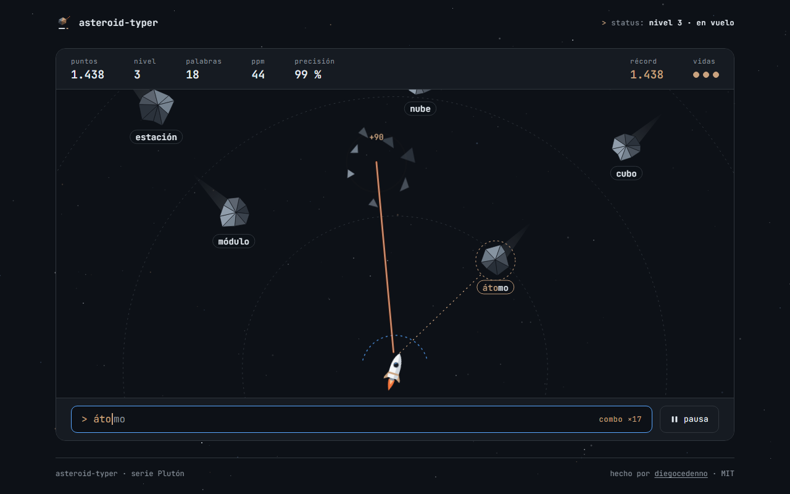

# asteroid-typer

> A typing game: asteroids carrying words fall towards your ship and you destroy them by typing them. Levels, WPM, accuracy and a saved high score, with Spanish and English word lists.
>
> Un juego de mecanografía: asteroides con palabras caen hacia tu nave y los destruyes escribiéndolas. Niveles, PPM, precisión y récord guardado, con palabras en español e inglés.

**[Live demo · Demo en vivo →](https://diegocedenno.github.io/asteroid-typer/)**

**[English](#english)** · **[Español](#español)**

---

## English

### What it does

- Press `Enter` to lift off. Low-poly asteroids fall towards the rocket, each one carrying a word.
- Type the first letter and the ship locks onto the nearest asteroid starting with it; correct letters light up, and finishing the word fires a laser that shatters the rock into its own facets.
- A typo only costs accuracy. An asteroid that reaches the shield costs one of three lives.
- Every 8 words the level goes up: faster falls, more asteroids, longer words. Consecutive words without a mistake build a combo.
- The HUD tracks score, level, words, WPM (`correct characters / 5 / minutes played`), accuracy and your record, which is kept in `localStorage`.
- Word language: Spanish, English or mixed (600+ words, grouped by length). A calm mode slows everything down.

### What makes it technically interesting

- **Rules without a DOM.** `js/game.js` is a pure state machine (`step(dt)`, `type(char)`, `release()`): spawning, targeting, levels, scoring. It runs under Node, so the rules are tested with a seeded PRNG and no browser. `js/scene.js` only draws what the state says.
- **Text comes from `input`, not `keydown`.** A real `<input>` is the text source, so dead keys (`´` + `a` → `á`), IME composition and on-screen keyboards all work. Each event is diffed against the last processed value, so a composition that grows letter by letter (Android) types exactly one letter at a time. A sentinel space keeps the field non-empty so Backspace always produces an event.
- **A deliberate accent policy.** Spanish words keep their real spelling, but a plain vowel matches an accented one (`a` ≈ `á`), so keyboards without dead keys are not punished. `ñ` is its own letter: `n` does not match it.
- **One loop, transforms only.** A single `requestAnimationFrame` loop with a time delta moves everything, writing just `transform` per frame. Even the dotted aiming line is a unit segment placed with `translate · rotate · scale`. The loop stops on pause, on blur and when the tab is hidden.
- **Generated low-poly rocks.** Every asteroid is built from a seed: an irregular outline, an off-centre hub and one triangle per edge, shaded by how much each face looks at the light. When it is destroyed those same triangles fly apart.
- **Never two words with the same initial**, if it can be avoided: the picker excludes taken initials and recent words before relaxing its rules.
- **The SVG is never scaled.** The viewBox always equals the container in pixels, so word labels stay at 14 px from a 360 px phone to a 1920 px desktop, and fall time (not pixel speed) is what stays constant.
- **Mobile keyboard aware.** With the on-screen keyboard open the page measures `visualViewport`, hides header and footer, and fits the game to what is actually visible, keeping ship and input on screen.
- **Reduced motion is a first-class path.** Asteroids still fall (that is the game), but they do not spin, the ship does not swing, there are no fragments, trails or shakes: destruction is a fade.
- **Accessible menus.** Native radios, checkbox and buttons, visible focus, level-ups and the final summary announced through a live region.
- **Zero dependencies, zero build.** Plain HTML, CSS and JavaScript. Fonts are bundled; nothing is requested from the network.

### Keyboard

| Key | Action |
| --- | --- |
| `Enter` | Start, resume, play again |
| Letters | Lock onto an asteroid and type its word |
| `Backspace` | Release the current target |
| `Esc` | Release the target; with no target, pause or resume |
| `Tab` | Move through the menu (leaving the text box pauses the game) |

### Run it

Double-click `index.html`. That is all — there is no build step and no server.
It also works as-is on GitHub Pages.

### License

[MIT](LICENSE) © Diego Cedeño. Inter and JetBrains Mono are bundled under the [SIL Open Font License](assets/fonts/).

---

## Español

### Qué hace

- Pulsa `Enter` para despegar. Asteroides low-poly caen hacia el cohete, cada uno con su palabra.
- Escribe la primera letra y la nave fija el asteroide más cercano que empiece por ella; las letras acertadas se iluminan y, al terminar la palabra, un láser rompe la roca por sus propias caras.
- Un error solo baja la precisión. Un asteroide que llega al escudo cuesta una de las tres vidas.
- Cada 8 palabras sube el nivel: caída más rápida, más asteroides y palabras más largas. Las palabras seguidas sin fallo acumulan combo.
- El marcador lleva puntos, nivel, palabras, PPM (`caracteres correctos / 5 / minutos jugados`), precisión y tu récord, que se guarda en `localStorage`.
- Idioma de las palabras: español, inglés o mixto (más de 600 palabras, agrupadas por longitud). El modo calma lo ralentiza todo.

### Qué lo hace interesante técnicamente

- **Reglas sin DOM.** `js/game.js` es una máquina de estados pura (`step(dt)`, `type(letra)`, `release()`): aparición, puntería, niveles y puntos. Corre en Node, así que las reglas se prueban con un PRNG con semilla y sin navegador. `js/scene.js` solo dibuja lo que dice el estado.
- **El texto llega por `input`, no por `keydown`.** La fuente de texto es un `<input>` real, de modo que funcionan las teclas muertas (`´` + `a` → `á`), la composición de los IME y los teclados en pantalla. Cada evento se compara con el último valor procesado, así una composición que crece letra a letra (Android) teclea exactamente una letra cada vez. Un espacio centinela mantiene el campo no vacío para que Retroceso siempre genere un evento.
- **Una política de tildes pensada.** Las palabras en español se escriben como son, pero la vocal sin tilde vale por la acentuada (`a` ≈ `á`), para no castigar a los teclados sin teclas muertas. La `ñ` es otra letra: la `n` no la sustituye.
- **Un solo bucle, solo transforms.** Un único `requestAnimationFrame` con delta de tiempo lo mueve todo y solo escribe `transform` en cada frame. Hasta la línea de puntería es un segmento unitario colocado con `translate · rotate · scale`. El bucle se detiene en pausa, al perder el foco y con la pestaña oculta.
- **Rocas low-poly generadas.** Cada asteroide nace de una semilla: un contorno irregular, un centro desplazado y un triángulo por arista, sombreado según cuánto mira cada cara hacia la luz. Al destruirlo, esos mismos triángulos salen despedidos.
- **Nunca dos palabras con la misma inicial**, si puede evitarse: el selector descarta las iniciales ocupadas y las palabras recientes antes de relajar sus reglas.
- **El SVG no se escala.** El viewBox mide siempre lo mismo que el contenedor en píxeles, así que las palabras se quedan en 14 px desde un móvil de 360 px hasta un escritorio de 1920 px, y lo que se mantiene constante es el tiempo de caída, no la velocidad en píxeles.
- **Convive con el teclado del móvil.** Con el teclado en pantalla abierto la página mide `visualViewport`, esconde cabecera y pie y ajusta el juego a lo que de verdad se ve, con la nave y la caja de texto a la vista.
- **El movimiento reducido es un camino de primera clase.** Los asteroides siguen cayendo (es el juego), pero no giran, la nave no oscila y no hay fragmentos, estelas ni sacudidas: la destrucción es un fundido.
- **Menús accesibles.** Radios, casilla y botones nativos, foco visible, y los cambios de nivel y el resumen final se anuncian en una región viva.
- **Cero dependencias, cero build.** HTML, CSS y JavaScript sin más. Las fuentes van incluidas; no se pide nada a la red.

### Teclado

| Tecla | Acción |
| --- | --- |
| `Enter` | Empezar, reanudar, jugar de nuevo |
| Letras | Fijar un asteroide y escribir su palabra |
| `Retroceso` | Soltar el objetivo actual |
| `Esc` | Soltar el objetivo; sin objetivo, pausar o reanudar |
| `Tab` | Recorrer el menú (salir de la caja de texto pausa la partida) |

### Cómo correrlo

Doble clic en `index.html`. Nada más: no hay build ni servidor.
También funciona tal cual en GitHub Pages.

### Licencia

[MIT](LICENSE) © Diego Cedeño. Inter y JetBrains Mono se incluyen bajo la [SIL Open Font License](assets/fonts/).
